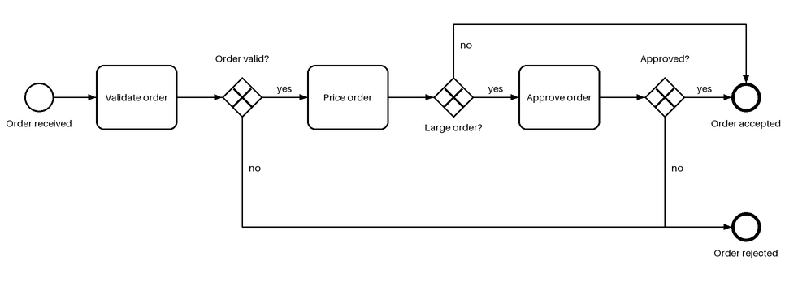

# Typed Variables — example

An order-processing process on Spring Boot and PostgreSQL in which one class, `OrderVariables`, declares every process
variable and is used by two delegates, an execution listener, the service that starts the process and the integration test.

## What it shows

- One declaration per variable (`ORDER`, `STATUS`, `TOTAL_CENTS`, ...) in [`OrderVariables`](src/main/java/org/operaton/extensions/plugin/typedvariables/example/OrderVariables.java), with names that the BPMN conditions (`${valid}`, `${needsApproval}`, `${approved}`) share.
- The order as a JSON object variable through Spin, a list of validation errors, an enum status, a date and booleans, all read and written without casts.
- A missing variable failing loudly: a process started without the order ends in an incident that names the variable and the activity.
- Tests asserting on variables with the same constants (`operaton-plugin-typed-variables-test`).

## Process model



`src/main/resources/bpmn/order-processing.bpmn`: Order received, Validate order (async, one try), gateway "Order valid?", Price
order, gateway "Large order?" (total above 1000.00 goes to the user task Approve order for the group `managers`), gateway
"Approved?", and the end events Order accepted and Order rejected. Open it in bpmn.io or Cockpit.

## Prerequisites

JDK 21, Docker (Compose).

## Run it

```bash
chmod +x ../../../mvnw
../../../mvnw -f .. -DskipTests install   # once: the example uses the extension's artifacts from the local repository
docker compose up -d --wait               # PostgreSQL :5432 (operaton / operaton)
../../../mvnw spring-boot:run
# Cockpit / Tasklist: http://localhost:8080 (demo / demo)
```

## Walkthrough

Submit an order the way the shop would; the controller starts the process with the order as a JSON variable:

```bash
curl -s -X POST http://localhost:8080/orders -H 'Content-Type: application/json' -d '{
  "id": "A-1", "customer": "alice",
  "lines": [{"sku": "book", "quantity": 2, "unitPriceCents": 1500}]
}'
```

Watch the instance in Cockpit (History) and its variables, including the `order` object with the data format `application/json`.

- **Happy path, small order**: validated, priced (3000 cents), no approval needed, `status` ends as `ACCEPTED`.
- **Large order**: with `"unitPriceCents": 90000` and `quantity` 2 the total is above the threshold; the process waits in
  Tasklist at Approve order (log in as `demo`, claim it). Complete it with the variable `approved` (Boolean): `true` ends as
  `ACCEPTED`, `false` as `REJECTED`.
- **Invalid order**: an empty customer or a quantity of 0 ends as `REJECTED`; `validationErrors` lists why.
- **Error path**: start the process without the `order` variable (Tasklist, Start process, no variables). The job of
  Validate order fails and Cockpit shows an incident:
  `Required variable 'order' is missing or null in execution ... (activity validate-order)`.

## How it works

- [`OrderVariables`](src/main/java/org/operaton/extensions/plugin/typedvariables/example/OrderVariables.java): the declarations. `OrderVariables.ALL` is a `VariableSet` built from the class.
- [`OrderController`](src/main/java/org/operaton/extensions/plugin/typedvariables/example/OrderController.java): `POST /orders`, the shop's entry point.
- [`OrderService`](src/main/java/org/operaton/extensions/plugin/typedvariables/example/OrderService.java): starts the process with `TypedVariables.builder().set(ORDER, order).build()`.
- [`ValidateOrderDelegate`](src/main/java/org/operaton/extensions/plugin/typedvariables/example/ValidateOrderDelegate.java) and [`PriceOrderDelegate`](src/main/java/org/operaton/extensions/plugin/typedvariables/example/PriceOrderDelegate.java): `ORDER.get(execution)`, `VALID.set(execution, ...)`, `TOTAL_CENTS.set(execution, ...)`.
- [`OrderStatusListener`](src/main/java/org/operaton/extensions/plugin/typedvariables/example/OrderStatusListener.java): an execution listener on the start and end events (status from the `status` field in the BPMN).
- `application.yaml`: the datasource, history level `full` (the test asserts on the historic instance) and the approval threshold.
- Spin (`operaton-engine-plugin-spin`, `operaton-spin-dataformat-json-jackson`) is a dependency of the example, which makes `customVariable` and `listVariable` store JSON.

## Run the tests

```bash
../../../mvnw verify          # Testcontainers (PostgreSQL), Docker required
```

`OrderProcessingIT` runs the small, large (approved and declined), invalid, HTTP-submitted and no-order cases end to end, asserts the
variables with `TypedVariablesAssertions`, checks that the order is stored as `application/json` and that the incident
message names the missing variable.
